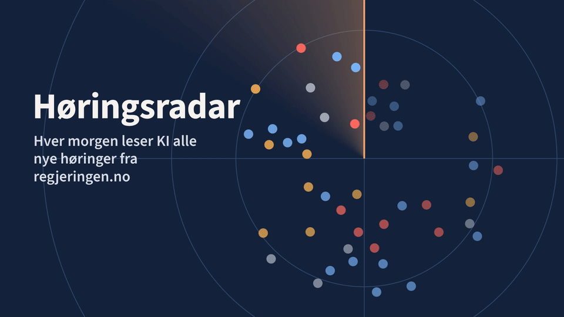

# Høringsradar



Finner nye lovforslag og sorterer dem etter hvor mye de angår personvern. Resultatet er en PDF-rapport som peker på hvor i dokumentene personvern berøres, med sidetall og ordrett sitat.

Pilot, kjører på en privat lab.

## To radarer

| | Høringsradar | EU/EØS-radaren |
|---|---|---|
| Følger | Høringer på regjeringen.no | Nye forslag fra EU-kommisjonen |
| Kjører | Hver dag | Hver uke |
| Vurderes | Alle høringer | Forslag som slipper gjennom et forfilter. Antallet som filtreres bort, vises |
| I tillegg | Om målvirksomheten står på adresselisten | EØS-status, EDPS-uttalelser, frister på Have Your Say og status i Europaparlamentet |

Radarene har hver sin målgruppe, rapport, database og adminpanel.

## Hva den gjør, og ikke gjør

- En LLM setter relevans (høy, middels, lav eller ingen) og viser hvor i dokumentene personvern berøres.
- Hvert sitat kontrolleres mot dokumentet. Et sitat som ikke finnes der, merkes i rapporten.
- Datoer, frister og departement hentes fra kilden, aldri fra LLM-en.
- Den skriver aldri høringsinnspill og tar ikke stilling til forslagene.

## Kom i gang

Krever Python 3.12, [uv](https://docs.astral.sh/uv/) og Pango for PDF-ene ([WeasyPrint](https://doc.courtbouillon.org/weasyprint/stable/first_steps.html)).

```bash
uv sync
cp .env.example .env              # sett ANTHROPIC_API_KEY
uv run horingsradar run           # hent og vurder nye høringer
uv run horingsradar report        # lag PDF-rapporten
uv run horingsradar web           # adminpanelet
```

EU/EØS-radaren kjører som en egen instans, i en egen mappe med `.env` laget fra `.env.eu.example`. Kommandoen er `uv run horingsradar-eu`.

Tester (uten nett og uten ekte LLM-kall):

```bash
uv run pytest
uv run ruff check .
```

## Mer

- Installasjon på Proxmox-LXC: [Høringsradar](docs/INSTALL-LXC.md) og [EU/EØS-radaren](docs/INSTALL-EU.md)
- Krav: [Høringsradar](docs/SPEC.md) og [EU/EØS-radaren](docs/EU-SPEC.md)
- Plan og beslutninger: [Høringsradar](docs/PLAN.md) og [EU/EØS-radaren](docs/EU-PLAN.md)
- Endringer: [CHANGELOG.md](CHANGELOG.md)

Adminpanelet lytter bare på LAN. For tilgang utenfra kan Tailscale kjøre på Proxmox-verten som subnet router. Bruk aldri `tailscale funnel`.

## Lisenser

Fontene er Source Sans 3 (SIL Open Font License). htmx er BSD Zero Clause License.
